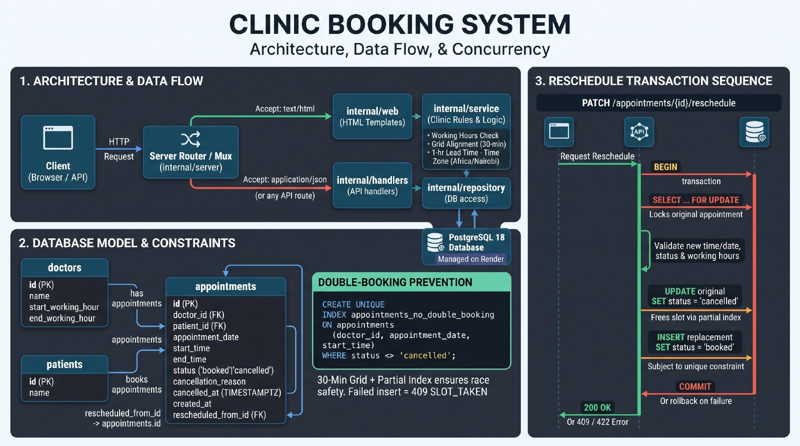

# Clinic Booking System

A REST API for a small clinic with five doctors. Patients see which 30-minute slots are free for
a doctor on a given day, book one, cancel it, or move it to a different slot. A booked slot can
never be double-booked.

Built in Go with PostgreSQL. Standard library only, plus the Postgres driver. The same binary
serves the patient-facing site.

| | |
|---|---|
| **Live site** | <https://clinic-booking-system-1-yu19.onrender.com> |
| **Live API** | <https://clinic-booking-system-1-yu19.onrender.com/api/doctors> |
| **API reference** | <https://clinic-booking-system-1-yu19.onrender.com/docs> |
| **OpenAPI document** | <https://clinic-booking-system-1-yu19.onrender.com/openapi.json> |

This file answers all four sections of the assessment. The API reference, the local setup, the
test matrix, the deployment reference, the known limitations and the design system are in
[`reference.md`](reference.md).

## Section 1: system design

*The assessment asks for the models and components, the key decisions, and the trade-offs
considered. Those are below.*

### Models

```
doctors
  id                 BIGSERIAL PK
  name               TEXT
  start_working_hour TIME
  end_working_hour   TIME

patients
  id   BIGSERIAL PK
  name TEXT

appointments
  id                  BIGSERIAL PK
  doctor_id           BIGINT FK -> doctors
  patient_id          BIGINT FK -> patients
  appointment_date    DATE
  start_time          TIME
  end_time            TIME
  status              TEXT   ('booked' | 'cancelled')
  cancellation_reason TEXT
  cancelled_at        TIMESTAMPTZ
  created_at          TIMESTAMPTZ
  rescheduled_from_id BIGINT FK -> appointments
```

Appointment times are naive wall-clock values in the clinic's timezone. The audit columns are
absolute instants. The split is deliberate: "the doctor works 09:00 to 17:00" is a local concept,
while "when was this row cancelled" is an event on a timeline.

### Components

The architecture is **hexagonal**, also called ports and adapters. The clinic's rules are the
middle, and everything else attaches to them from the outside.

[](docs/sys_design_photo.jpg)

The diagram reads left to right. A request arrives at the router, which is the only place that
knows both the HTML site and the JSON API exist. The `Accept` header decides which of the two
answers it. From there the request becomes a method call on the service layer, which is the
middle of the hexagon: it holds the rules, and it knows nothing about HTTP, templates, SQL or
Postgres. The repository is the only thing that knows how to talk to the database.

That is the port. The service layer declares the interface it needs from storage
(`service.Repository`), and the Postgres implementation satisfies it structurally, without the
service layer importing it or knowing that Postgres exists. The rules never depend on the
database, which is what lets the rule tests run without one.

The same arrangement holds on the way in. The handlers and the site are **driving adapters**:
they take a request and turn it into a call on the service. The repository is the **driven
adapter**: it takes a call and turns it into a query. Swapping either side, for a different
database or a different transport, touches nothing in the middle.

Because the middle is the whole product, the rules live there as pure functions over plain
values, and the clock is injected rather than read from the inside, so a test can pin it to an
exact instant:

```go
func ValidateSlot(doctor *models.Doctor, date, start time.Time, now time.Time, loc *time.Location) error
```

The site (`internal/web`) sits alongside the API rather than above it. It reads through the same
service layer and renders Go templates, so it works without JavaScript and the JSON contract is
untouched. Three paths exist as both a page and an endpoint, and they negotiate on the `Accept`
header: a browser gets the page, `curl` gets JSON. The whole API is also mounted under `/api`,
where it is always JSON.

Every endpoint is described by an OpenAPI 3.1 document, served at `/openapi.json` and rendered at
`/docs`. The route table in `internal/server/routes.go` drives the router and is compared
against that document by a test, so a route cannot be added without it being documented.

### Slots

A doctor's shift is divided into consecutive 30-minute slots anchored at the start of the shift.
A 09:00 to 17:00 shift gives 16 slots, from 09:00 through 16:30.

Three rules decide whether a slot can be booked. Working-hours bounds are inclusive, so a 09:00
start is valid and a 16:30 start is valid because it ends exactly at 17:00, but a 17:00 start is
not. Grid alignment is mandatory, so a 09:15 start is rejected. A slot must also be at least an
hour away from now, and a slot starting exactly 60 minutes away is allowed.

Grid alignment is what makes the database constraint sufficient. With a fixed 30-minute duration
and aligned starts, two appointments can only overlap if they start at the same instant, and this
index catches that:

```sql
CREATE UNIQUE INDEX appointments_no_double_booking
    ON appointments (doctor_id, appointment_date, start_time)
    WHERE status <> 'cancelled';
```

Two clients racing for one slot cannot both win: the second insert violates the index and is
reported as `409 SLOT_TAKEN`. Cancelling frees the slot with no cleanup job, because the index is
partial and the cancelled row leaves it. The API never checks availability and then inserts. It
inserts and lets the index decide.

### Rescheduling

A reschedule cancels the original and inserts a replacement, in one transaction:

```
BEGIN
  SELECT ... FOR UPDATE            -- lock the appointment row
  re-check status and start time
  UPDATE original SET status='cancelled', cancellation_reason='rescheduled'
  INSERT replacement SET status='booked', rescheduled_from_id=<original>
COMMIT
```

The row lock stops two concurrent reschedules of the same appointment from both cancelling it
and inserting two replacements. If the replacement hits a taken slot the transaction rolls back
and the original appointment is still booked.

### Time

The clinic operates in one timezone, `Africa/Nairobi` by default and configurable with
`CLINIC_TZ`. To compare a stored slot against now, the service builds the slot's absolute instant
with `time.Date(..., clinicLoc)`. That is exact because Nairobi has a fixed +03:00 offset and no
daylight saving, so the wall-clock model depends on that.

The same lead-time predicate is used by `POST /appointments` and by
`GET /doctors/{id}/availability`, which is why the API never offers a slot it would then refuse.

### Decisions and trade-offs

**PostgreSQL, not SQLite.** The brief's requirements are concurrency requirements, and
PostgreSQL is where they are testable: a partial unique index, a row lock, a transaction that
rolls back, two connections genuinely competing. The cost is a managed database in production and
a service container in CI. The benefit is that the central claim, that a slot cannot be
double-booked, is enforced by the database and shown by a test with eight goroutines racing for one
slot.

**Wall-clock times, not `TIMESTAMPTZ`.** The domain is local. Storing the times naively makes the
grid arithmetic trivial and the partial index obviously correct, and it makes the API's
`start_time: "09:30"` mean what it says. The trade-off is that the model assumes a single
DST-free zone, and a second clinic in another zone would need revisiting.

**A partial unique index, not application-level checks.** Checking whether a slot is free and then
inserting it leaves a race window, and the window is where double-bookings come from. The
application attempts the insert optimistically and translates the `23505` violation into `409`.
The `WHERE status <> 'cancelled'` clause is what makes cancelling free the slot without a cleanup
job. A range exclusion constraint would allow variable-length appointments; it was not used
because the duration is fixed, which makes identical start times the only possible overlap.

**The standard library router.** Go 1.22's `ServeMux` understands method-and-wildcard patterns
natively, so `GET /doctors/{id}/availability` needs no router dependency. The middleware this
service needs is about forty lines.

**Cancel and re-insert for rescheduling.** It preserves the history, and `rescheduled_from_id`
links the replacement to its predecessor. The cost is that the appointment id changes and the
patient sees two entries in their history, one cancelled and one booked.

**A hexagonal service layer, with rules as pure functions.** The service layer is the port the
adapters plug into, so the rules are testable without a database and without an HTTP server. The
injected clock lets the one-hour boundary be asserted exactly rather than approximately. The
alternative, rules living in the handlers, is where a lot of Go web services put them, and it
couples the clinic's rules to the transport.

**No authentication.** The brief does not ask for it and its scope is booking logic. Inventing a
user model and a session story would have left them untested against real requirements. The
honest gap is that the endpoints are unauthenticated and un-rate-limited, so anyone who can reach
the deployment can book and cancel.

**400 for unreadable requests, 422 for disallowed ones.** A malformed body or an unparseable date
is `400`. A date that parses but falls outside the doctor's hours is `422`. Making everything
`400` is simpler, but it collapses "you sent nonsense" and "that slot is not available" into the
same answer.

## Section 2: API implementation and its documentation

*The assessment asks for the REST API, the validation behind it, and meaningful errors with
correct status codes. This section lists the endpoints and the changes made to the API
documentation. The full reference, with every request and response body, is in
[`reference.md`](reference.md).*

### The endpoints

| Method | Path | What it does |
|---|---|---|
| `GET` | `/doctors` | List the doctors |
| `GET` | `/doctors/{id}` | Get one doctor |
| `GET` | `/doctors/{id}/availability` | List the free slots for a doctor on a date |
| `GET` | `/patients/{id}` | Get one patient |
| `GET` | `/patients/{id}/appointments` | List a patient's appointments, soonest first |
| `POST` | `/appointments` | Book an appointment |
| `PATCH` | `/appointments/{id}/cancel` | Cancel an appointment and free its slot |
| `PATCH` | `/appointments/{id}/reschedule` | Move an appointment to another slot |
| `GET` | `/healthz` | Check that the service and its database are up |

The same nine routes are also mounted under `/api`, where they always answer with JSON. The
three that share a path with a page negotiate on the `Accept` header, which the document explains.

### The API documentation changes

The API had a list of endpoints in the README and a handler for each route, and nothing that
connected the two. A reader had to take the documentation on trust. These are the changes.

An OpenAPI 3.1 document now describes all nine endpoints. It lives at
`internal/openapi/openapi.json`, is served as JSON at `/openapi.json`, and is rendered with a
browsable reference at `/docs`.

The domain rules moved into the document. Its description now explains how slots are divided,
why the working-hours bounds are inclusive, why starts must land on the half hour, what the
one-hour notice means, and how the database refuses a double booking. A client developer meets
the rules where they need them, rather than in a separate file.

Every operation carries a request example and a response example, taken from the seeded doctors
and patients, and each of the four common failures has a worked example.

The error vocabulary is a reusable schema whose `code` is an enum of all fourteen error codes,
so it is in the document rather than scattered through prose. Reusable components cover the
path ids, the date query parameter, the `include_cancelled` flag and the four common failure
responses.

The document is embedded in the binary, so the deployed service carries the description of the
API it is actually serving. There is no second copy to drift.

The route table moved out of `cmd/api` into `internal/server/routes.go`, so one table drives
both the router and the tests. The route table is now the contract.

Eight drift tests keep the document honest. The build fails if a route is not documented, if the
document describes a path nothing serves, if two operations share an `operationId`, if an error
code is missing from the vocabulary, if a `$ref` resolves to nothing, if a component is never
referenced, or if the file was edited without being rebuilt into the binary.

The public contract did not change. A route cannot be added without being documented, and a
documented route cannot drift from the code.

### The error vocabulary

Every failure uses one envelope: an `error` object with a stable `code`, a human-readable
`message` and optional `details`.

| Status | Codes | What it means |
|---|---|---|
| `400` | `INVALID_JSON`, `INVALID_REQUEST`, `INVALID_DATE`, `INVALID_TIME` | The request could not be read |
| `404` | `DOCTOR_NOT_FOUND`, `PATIENT_NOT_FOUND`, `APPOINTMENT_NOT_FOUND` | The resource does not exist |
| `409` | `SLOT_TAKEN`, `APPOINTMENT_ALREADY_CANCELLED` | The resource is in a conflicting state |
| `422` | `OUTSIDE_WORKING_HOURS`, `SLOT_NOT_ALIGNED`, `TOO_SOON`, `APPOINTMENT_IN_PAST` | The request was read but is not allowed |
| `500` | `INTERNAL_ERROR` | Something went wrong on the server |

`400` means the request could not be read. `422` means it was read and is not allowed.

## Section 3: deployment and CI/CD

*The assessment asks for the public URL, the branch that triggers a deploy and how, and a brief
description of what the pipeline does.*

### What is deployed

Render runs the service as a Docker web service with a managed PostgreSQL 18 instance, from
`render.yaml` in this repository.

| | |
|---|---|
| **Live site** | <https://clinic-booking-system-1-yu19.onrender.com> |
| **Live API** | <https://clinic-booking-system-1-yu19.onrender.com/api/doctors> |
| **Health check** | <https://clinic-booking-system-1-yu19.onrender.com/healthz> |
| **API reference** | <https://clinic-booking-system-1-yu19.onrender.com/docs> |
| **Deploy trigger** | a push to `main` |
| **Database** | Render managed PostgreSQL 18, free plan |

### The pipeline

`.github/workflows/ci.yml` runs two jobs.

`test` runs on every pull request and every push to `main`: `go mod verify`, `go vet ./...`,
`go test -race ./...` with a `postgres:18` service container so the integration tests run rather
than skip, and `go build ./...`.

`publish` runs only on a push to `main`, and only if `test` passed. It builds the Docker image
and pushes it to Docker Hub, tagged with the commit SHA and `latest`. The job skips itself with a
notice when `DOCKERHUB_USERNAME` and `DOCKERHUB_TOKEN` are missing, so a misconfigured pipeline
never turns `main` red. Pull requests never touch the live environment.

### How a deploy is triggered

```
PR opened ────► Actions: test ────► must pass to merge
                      │
merge to main ───────┴──► Actions: test ──► (passes)
                                             │
                                             ▼
                          Render: autoDeployTrigger: checksPass
                          Render sees the checks passed on main
                          and rebuilds the Dockerfile and redeploys
```

`autoDeployTrigger: checksPass` in `render.yaml` closes the loop. Render watches the linked
branch and waits for its CI checks to pass before it deploys, so a red test suite on `main` blocks
the release. The pipeline gates the deploy rather than running alongside it. The CI workflow
therefore does not also call Render's deploy hook, because that would deploy twice.

Two more secrets are optional. `RENDER_API_KEY` and `RENDER_WORKSPACE_ID` let CI validate
`render.yaml` against Render's own Validate Blueprint endpoint, so a broken blueprint fails a
pull request check rather than a deployment. Without them the step is skipped with a notice.

Operating detail, including how to launch the service on Render, how to upgrade the database and
what to do when a deploy fails, is in [`reference.md`](reference.md).

## Section 4: AI reflection

*The assessment asks what AI was used for across the four sections, one example where an AI
suggestion improved the work and the prompt behind it, one example where the output was wrong and
how it was caught, and two decisions made without AI.*

Most of the code was written by the AI. My part was to write the spec for each piece of work,
review what came back, and decide the things that needed deciding.

### 1. What I used AI for

**Section 1 (design).** I ran the brief through the `grill-me` skill, which interrogates a plan
for holes and contradictions instead of confirming it. It found the missing timezone, the
unstated appointment duration, the missing service layer and the reschedule race, none of which I
had spotted. I turned each into an explicit decision, recorded in `AGENTS.md` and above.

**Section 2 (implementation).** I wrote a spec for each pull request and the AI built it: the
service layer and its table-driven tests, the repository and its transactions, the handlers, the
patient-facing site, the Docker image and the CI workflow. I reviewed the diffs and wrote the
spec for the review you are reading now.

**Section 3 (deployment).** The spec covered the Render blueprint, the Docker image and the
pipeline, down to the settings that only exist in a dashboard: the runtime, the auto-deploy
trigger and the branch it watches.

**Section 4 and the documentation.** I ran both documentation files through the
`blader/humanizer` skill, which catalogues the habits that make a passage read as machine-written:
contrasts that only add weight, one-line closers that restate the paragraph above them, triads
and dashes applied by habit, and bold labels on every item of a list. Removing them changed the
prose without changing a fact.

### 2. Where it improved the work

**Prompt:** the brief, handed to the `grill-me` skill with the instruction to find the holes
before any code was written.

The useful thing that came back was that the prescribed unique index does not prevent
double-booking. The brief asked for a composite unique index on `(doctor_id, appointment_date,
start_time)`, which prevents two appointments starting at the same instant and says nothing about
two that overlap. A 09:15 appointment inserted alongside a 09:00 one violates nothing, because
09:15 is a distinct key, and the doctor ends up double-booked.

The follow-on question has a clean answer. The index suffices when every appointment is exactly
30 minutes long and every start lands on the 30-minute grid, because then overlap implies an
identical start time. So the fix was to make the duration fixed and the grid mandatory, which
the brief had left as an unstated assumption. That changed the schema, the service layer and the
test suite. Reading the brief on my own, I would not have spotted the gap, because the index in
the brief looks like it does the job.

### 3. Where it was wrong

The AI assumed `pgx` would return `TIME` and `DATE` columns as `time.Time`, the way most ORMs
do. The first integration test against real PostgreSQL failed with `unsupported Scan, storing
driver.Value type string into type *time.Time`, because through `database/sql` `pgx` hands `TIME`
back as the text `"09:00:00"`. The fix was to scan into `any` and convert explicitly, accepting
either representation.

No unit test could have caught it. It only appeared once the code ran against a real database,
which is why the integration tests were worth writing. Two more mistakes the tests caught are
recorded in [`reference.md`](reference.md).

### 4. Two decisions I made without the AI

**Where the "this appointment has already started" rule belongs.** The brief puts it in the
repository, inside the transaction. I put it in the service layer, which owns the business rules,
with the repository re-checking it under the row lock as a safety net. The reason is error
quality: the service can report "appointment 3 has already started and cannot be cancelled",
whereas a repository that returns only a sentinel error forces a generic message. Correctness
does not depend on where the check lives; the quality of the response does.

**Treating "already cancelled" as `409 Conflict` rather than `422 Unprocessable Entity`.** The
request is well-formed and the resource's state is what makes it impossible, which is what `409`
is for. `422` is for requests that are well-formed but inherently disallowed, such as a slot
outside working hours. This is a judgement about REST semantics rather than a technical fact, and
I would rather defend it than have it made by default.
